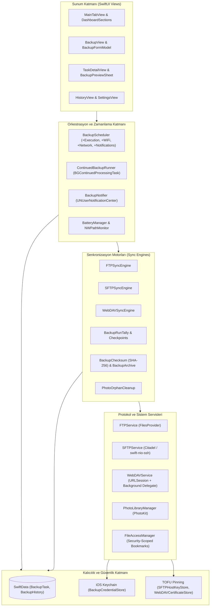
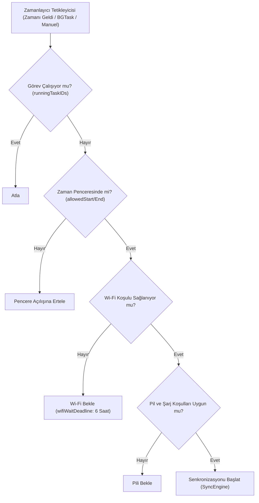
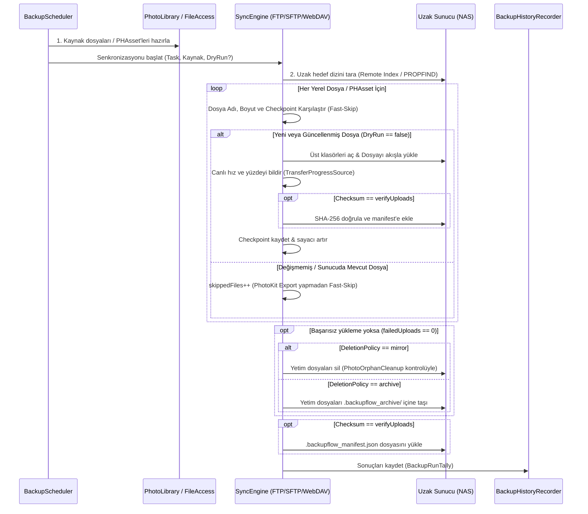

# BackupFlow — Sistem Mimarisi (Architecture)

Bu doküman, **BackupFlow** iOS uygulamasının katmanlı mimarisini, veri modellerini, protokol senkronizasyon motorlarını, arka plan zamanlayıcısını ve güvenlik altyapısını açıklar.

---

## 1. Mimari Genel Bakış

BackupFlow; **Swift 6 Concurrency (`async/await`, `@MainActor`, `Sendable`)**, **SwiftUI**, **Observation (`@Observable`)** ve **SwiftData** üzerine inşa edilmiş, modüler ve yerel öncelikli (local-first) bir mimariye sahiptir. Üçüncü taraf bir arka uç (backend) sunucusu yoktur; tüm iş mantığı iPhone/iPad üzerinde çalışır ve doğrudan kullanıcının hedef sunucusuyla (**SFTP**, **WebDAV**, **FTP**) iletişim kurar.

Uygulama, **Tek Seferlik Satın Alma (Paid Upfront Lifetime)** modeliyle çalıştığından kod tabanında StoreKit, Paywall veya kota kısıtlama katmanı bulunmaz; tüm mimari kesintisiz ve sınırsız veri aktarımı için optimize edilmiştir.



---

## 2. Dizin ve Modül Yapısı

```text
BackupFlow/
├── BackupFlowApp.swift                 # Uygulama giriş noktası, ModelContainer kurulumu, AppDelegate & BGTaskScheduler kaydı
├── Models/
│   ├── BackupModels.swift              # @Model BackupTask, BackupHistory ve temel enum'lar (BackupType, BackupFrequency vb.)
│   ├── BackupTarget.swift              # Protokol hedef türleri (FTP, SFTP, WebDAV) ve ikon/görünüm eşlemeleri
│   └── BackupExecutionModels.swift     # Dry-run önizleme (BackupPreviewResult) ve çalışma zamanı modelleri
├── Views/
│   ├── MainTabView.swift               # Ana Dashboard ekranı ve genel durum koordinasyonu
│   ├── Dashboard/                      # DashboardSections.swift & DashboardComponents.swift
│   ├── Backup/                         # BackupView, BackupFormModel, BackupFormSections, RemoteFolderPicker, DocumentPicker
│   ├── Tasks/                          # TaskDetailView, BackupPreviewSheet
│   ├── History/                        # HistoryView
│   ├── Settings/                       # SettingsView, BatterySettingsView
│   └── Views.swift                     # Ortak görünüm yardımcıları ve stil uzantıları
├── Services/
│   ├── BackupScheduler.swift           # Zamanlayıcı çekirdeği (+Execution, +WiFi, +Network, +Notifications uzantıları)
│   ├── ContinuedBackupRunner.swift     # iOS arka plan sürekli çalışma desteği (BGContinuedProcessingTask)
│   ├── FTPSyncEngine.swift             # FTP 4 aşamalı senkronizasyon motoru
│   ├── SFTPSyncEngine.swift            # SFTP 4 aşamalı senkronizasyon motoru
│   ├── WebDAVSyncEngine.swift          # WebDAV 4 aşamalı senkronizasyon motoru
│   ├── FTPService.swift                # FTP bağlantı, dosya/dizin işlemleri, ağ izleme ve hata eşleme
│   ├── SFTPService.swift               # Citadel tabanlı SSH/SFTP istemcisi
│   ├── WebDAVService.swift             # URLSession & PROPFIND XML tabanlı WebDAV istemcisi
│   ├── WebDAVBackgroundSessionDelegate.swift # WebDAV arka plan URLSession olay yönetimi
│   ├── PhotoLibraryManager.swift       # PhotoKit varlık tarama, iCloud indirme ve geçici dışa aktarma
│   ├── PhotoOrphanCleanup.swift        # Fotoğraf galerisi ayna (mirror) modu güvenlik kontrolleri
│   ├── FileAccessManager.swift         # Güvenlik kapsamlı yer imleri (Security-Scoped Bookmarks) yönetimi
│   ├── BackupArchive.swift             # Arşivleme mantığı, yol temizleme (path sanitization) ve rezerve dizin koruması
│   ├── BackupChecksum.swift            # SHA-256 bütünlük özeti hesaplama
│   ├── BackupCredentialStore.swift     # iOS Keychain güvenli parola saklama
│   ├── SFTPHostKeyStore.swift          # SSH Host Key parmak izi TOFU sabitleme
│   ├── WebDAVCertificateStore.swift    # TLS/SSL kendinden imzalı sertifika TOFU sabitleme
│   ├── TemporaryStorageMaintenance.swift # /tmp geçici dosya temizlik servisi
│   ├── BatteryManager.swift            # Pil seviyesi ve şarj durumu denetimi
│   ├── TransferProgressSource.swift    # Canlı aktarım hızı ve ilerleme takibi
│   ├── DesignSystem.swift              # Renk, tipografi, boşluk ve köşe yuvarlaklığı sabitleri
│   ├── ModernComponents.swift          # ModernCard, StatusBadge, StatCard, ModernProgressBar
│   └── Localization.swift              # 12 dil çeviri altyapısı
└── LocalPackages/
    ├── FilesProvider/                  # FTP istemcisi ve yerel dosya soyutlamaları
    └── BigInt/                         # Kriptografik büyük sayı kütüphanesi
```

---

## 3. Veri Modelleri ve Kalıcılık (SwiftData & Keychain)

### 3.1. `BackupTask` (`@Model`)
Her bir yedekleme görevini temsil eden ana SwiftData modelidir:
- **Kimlik ve İsimlendirme:** `id: UUID`, `displayName: String`, `createdAt: Date`.
- **Sunucu Yapılandırması:** `backupType: BackupType` (`.ftp`, `.sftp`, `.webdav`), `serverHost: String`, `serverPort: Int`, `serverUsername: String`, `serverPassword: String` (`keychain:<UUID>` referansı tutar; gerçek parola SwiftData'ya yazılmaz, Keychain'de saklanır), `destinationPath: String`.
- **Kaynak Tanımı:** `sourcePath: String?` (`"PHOTOS_LIBRARY"` veya yerel klasör yolu; klasör erişim izinleri `FileAccessManager` tarafından Security-Scoped Bookmarks ile saklanır).
- **Medya Ayarları:** `mediaType: MediaType` (`photosOnly`, `videosOnly`, `photosAndVideos`), `includeICloudAssets: Bool`. Fotoğraf ve videolar PhotoKit üzerinden `yyyyMMdd_HHmmss_<12-haneli-UUID>.ext` deterministik dosya adıyla dışa aktarılır.
- **Politikalar:** `deletionPolicyRaw: String?` (`@Transient var deletionPolicy: BackupDeletionPolicy` — yeni görevlerde varsayılan `.appendOnly`, ayrıca `.mirror` ve `.archive`), `checksumModeRaw: String?` (`@Transient var checksumMode: BackupChecksumMode` — `.off`, `.verifyUploads`).
- **Zamanlama ve Koşullar:** `frequency: BackupFrequency` (`manual`, `daily(time:)`, `weekly(day:time:)`, `monthly(day:time:)`, `intervalHours(Int)`), `scheduledTime: ScheduleTime?`, `scheduledWeekday: Int?`, `requiresWiFiValue: Bool?`, `allowCellularForLocalServer: Bool`, `requiresExternalPowerValue: Bool?`, `allowedStartTime: ScheduleTime?`, `allowedEndTime: ScheduleTime?`, `wifiWaitDeadline: Date?`, `isEnabled: Bool`, `isPaused: Bool`. (Minimum pil seviyesi eşiği `BatteryManager` üzerinde yönetilir).
- **Canlı Çalışma Durumu:** `backupStatus: BackupStatus`, `progress: Double`, `currentFile: String?`, `currentFileProgress: Double`, `currentFileBytesTransferred: Int64`, `currentFileTotalBytes: Int64`, `transferSpeedBytesPerSecond: Double`, `lastBackupDate: Date?`, `nextRunTime: Date?`, `lastError: String?`, `lastFailureCategoryRaw: String?`, `consecutiveFailureCountValue: Int?`.

### 3.2. `BackupHistory` (`@Model`)
Tamamlanan, ertelenen veya başarısız olan tüm yedekleme çalışmalarının detaylı denormalize kaydıdır:
- `id: UUID`, `timestamp: Date`, `status: String` (`completed`, `failed`, `cancelled`, `interrupted`, `deferred`).
- `duration: TimeInterval`, `bytesTransferred: Int64`, `totalBytes: Int64`, `filesProcessed: Int`, `totalFiles: Int`.
- `newFilesValue: Int?` (`newFiles`), `updatedFilesValue: Int?` (`updatedFiles`), `skippedFiles: Int`, `deletedFiles: Int`, `verifiedFilesValue: Int?` (`verifiedFiles`).
- `failureCategoryRaw: String?` (`@Transient var failureCategory: BackupFailureCategory?` — `.network`, `.auth`, `.permission`, `.server`, `.quota`, `.iCloud`, `.certificate`, `.cancelled`, `.unknown`), `errorMessage: String?`, `previewSummarySnapshot: String?`.
- Görev silinse bile geçmişin korunması için denormalize görev alanları: `taskDisplayName`, `taskSourcePath`, `taskServerHost`, `taskServerPort`, `taskUsername`, `taskIsAnonymous`, `taskMediaTypeRaw`.

### 3.3. `BackupCredentialStore` (Keychain)
Sunucu parolaları, cihaz kilitliyken bile ilk açılıştan sonra arka planda erişilebilir olan `kSecAttrAccessibleAfterFirstUnlockThisDeviceOnly` koruma sınıfıyla iOS Keychain'e yazılır. Bağlantı kapatıldığında (`disconnect()`) bellekteki parola referansları sıfırlanır.

---

## 4. Zamanlama ve Arka Plan Yaşam Döngüsü (`BackupScheduler`)

`BackupScheduler`, uygulamanın merkezi orkestrasyon motorudur:



### Arka Plan Çalışma ve Bildirim Mekanizmaları:
1. **`BGTaskScheduler` Tam Zamanlı Planlama:**
   - Uygulama `AppDelegate` üzerinden `tamersavasci.BackupFlow.backup` (`BGAppRefreshTask`) ve `tamersavasci.BackupFlow.processing` (`BGProcessingTask`) görevlerini kaydeder.
   - `scheduleProcessingTask()` ve `scheduleAppRefresh()`, yapay bir gecikme (`minimumLead`) eklemeden doğrudan görevin hesaplanan `nextRunTime` zamanına (`earliestBeginDate = max(nextBackupDate, Date().addingTimeInterval(10))`) kurulur.
2. **Protokol Bazlı Bildirim Ayrımı (`BackupNotifier`):**
   - **FTP ve SFTP:** Soket tabanlı oldukları ve iOS arka plan kısıtlamaları nedeniyle ekran kilitliyken kullanıcı etkileşimi gerektirebildikleri için zamanlanan saatte *"Yedeklemeye Hazır"* (`sendScheduledBackupNotification` / `refreshReminder`) interaktif hatırlatma bildirimi gönderilir.
   - **WebDAV:** `URLSessionConfiguration.background` desteklediği için kullanıcıya *"Yedeklemeye Hazır"* bildirimi **gönderilmez**; görev doğrudan arka planda sessizce başlatılır ve yalnızca tamamlandığında veya hata aldığında sonuç bildirimi iletilir.
3. **`ContinuedBackupRunner`:**
   - iOS 26+ cihazlarda `BGContinuedProcessingTaskRequest` API'sini kullanarak uzun süreli aktarımlara sistem düzeyinde ek çalışma süresi sağlar.
4. **WebDAV Kesintisiz Arka Plan Transferi ve Çoklu-GB Video Mimarisi (`WebDAVService` & `PhotoLibraryManager`):**
   - **UIKit 30sn Süre Sonu Koruması:** `WebDAVBackgroundTaskCoordinator` veya `AppDelegate` içindeki 30 saniyelik UIKit `beginBackgroundTask` süresi dolduğunda aktif WebDAV yedeklemesi **kesinlikle iptal edilmez**; `backgroundURLSession` (`nsurlsessiond`) ve `BGProcessingTask` aktarımı kesintisiz sürdürür.
   - **Ardışık Dosyalar Arası Askıya Alınma Koruması:** Bir `backgroundURLSession` yüklemesi bittiğinde sıradaki büyük video diske (`tmp/backupflow_exports`) hazırlanırken iOS'in uygulamayı hemen uyutmaması için `backgroundTaskCoordinator.begin()` yenilenir ve `backgroundURLSessionCompletionHandler` **180 saniyelik** emniyet penceresiyle (`scheduleBackgroundSessionCompletionFlush(after: 180.0)`) bekletilip sıradaki `uploadTask.resume()` çağrıldığı anda serbest bırakılır.
   - **Çoklu-GB Video Zaman Aşımları ve Dosya Koruması:** `PhotoLibraryManager.exportAssetToTemporaryFile` videolar için **10 dakika (600 sn)** dışa aktarma süresine, `.userInitiated` QoS önceliğine ve cihaz kilitliyken okunup yazılabilen `FileProtectionType.completeUntilFirstUserAuthentication` dosya korumasına sahiptir. `WebDAVService` arka plan oturumu ise çoklu-GB (ör. 2.5+ GB) videolar için `timeoutIntervalForResource = 7200` (2 saat) ve `timeoutIntervalForRequest = 300` (5 dakika) olarak yapılandırılmıştır.

---

## 5. 4 Aşamalı Senkronizasyon Boru Hattı (Sync Pipeline)

Tüm protokol motorları ([FTPSyncEngine.swift](file:///Users/tamersavasci/Documents/BackupFlow/BackupFlow/Services/FTPSyncEngine.swift), [SFTPSyncEngine.swift](file:///Users/tamersavasci/Documents/BackupFlow/BackupFlow/Services/SFTPSyncEngine.swift), [WebDAVSyncEngine.swift](file:///Users/tamersavasci/Documents/BackupFlow/BackupFlow/Services/WebDAVSyncEngine.swift) / [WebDAVService.swift](file:///Users/tamersavasci/Documents/BackupFlow/BackupFlow/Services/WebDAVService.swift)) aynı 4 aşamalı deterministik boru hattını uygular:



---

## 6. Güvenlik, Veri Bütünlüğü ve Hata Dayanıklılığı

1. **Rezerve Dizin Koruması ([BackupArchive.swift](file:///Users/tamersavasci/Documents/BackupFlow/BackupFlow/Services/BackupArchive.swift)):**
   - `.backupflow_archive` ve `.backupflow_manifest.json` yolları `BackupArchive.isReserved(_:)` ile korunur; yetim dosya temizliğinde asla silinmez veya taşınmaz.
   - `BackupArchive.sanitize(_:)` ve `safeRemotePath(basePath:relativePath:)` ile sunucu yolları arındırılarak Path Traversal (`..` veya `//`) saldırıları önlenir.
2. **Fotoğraf Galerisi Yetim Silme Emniyeti ([PhotoOrphanCleanup.swift](file:///Users/tamersavasci/Documents/BackupFlow/BackupFlow/Services/PhotoOrphanCleanup.swift)):**
   - Kaynak `PHOTOS_LIBRARY` olduğunda `mirror` modunda sunucudan dosya silinebilmesi için **tam fotoğraf izni (`.authorized`)** ve **`visibleAssetCount > 0`** şarttır. Sınırlı erişim (`.limited`) veya boş galeri durumunda sunucudaki fotoğraflar kesinlikle silinmez.
3. **TOFU Sabitleme (Trust-On-First-Use Pinning):**
   - **SFTP:** `SFTPHostKeyStore` SSH sunucusunun public key SHA-256 parmak izini ilk bağlantıda kaydeder. Sonraki bağlantılarda eşleşme bozulursa bağlantı `.certificate` hatasıyla anında kesilir.
   - **WebDAV:** `WebDAVCertificateStore` kendinden imzalı yerel SSL sertifikalarının parmak izini kaydeder ve MITM saldırılarına karşı korur.
4. **SwiftData Detached Model Koruması:**
   - Ayarlar üzerinden "Tüm Verileri Sıfırla" veya görev silme işlemlerinde SwiftUI `@Query` nesnelerinin anlık `modelContext == nil` olma riskine karşı tüm görünümlerde `tasks.filter { $0.modelContext != nil }` koruyucu filtresi uygulanır.
5. **Bellek, Fast-Skip ve Depolama Yönetimi:**
   - `WebDAVService.uploadPhotoAssets`, sunucuda zaten var olan (`existingFileMap[fileName].size > 0`) fotoğraf ve videolar için PhotoKit XPC (`PHAssetResource`) sorgusu veya geçici disk dışa aktarımı yapmadan doğrudan **Fast-Skip** uygular.
   - Fotoğraf ve video export işlemlerinde `tmp/backupflow_exports` dizini kullanılır; her dosya yüklemesi bittiğinde `defer` bloğuyla anında silinir ve `TemporaryStorageMaintenance` ile uygulama açılışında/bitişinde temizlenir.
